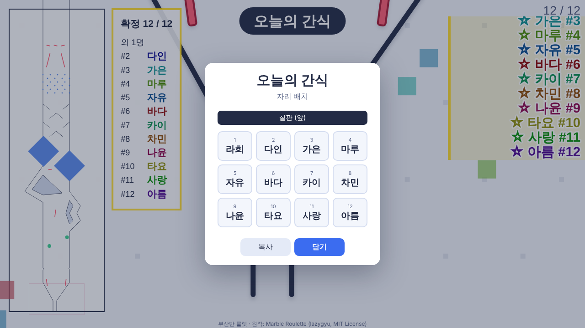
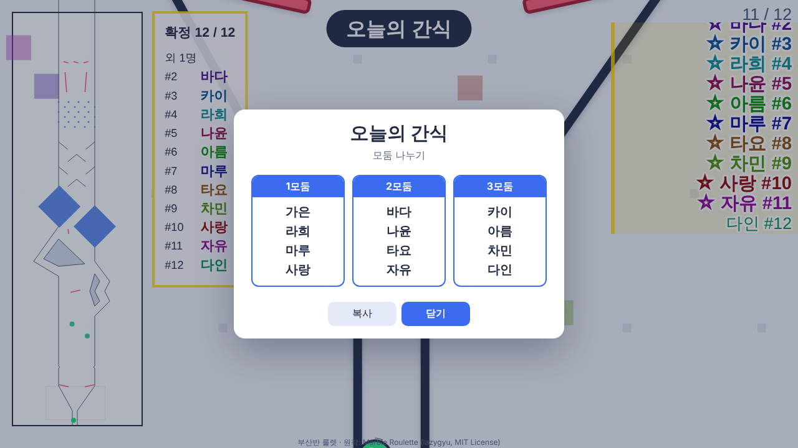
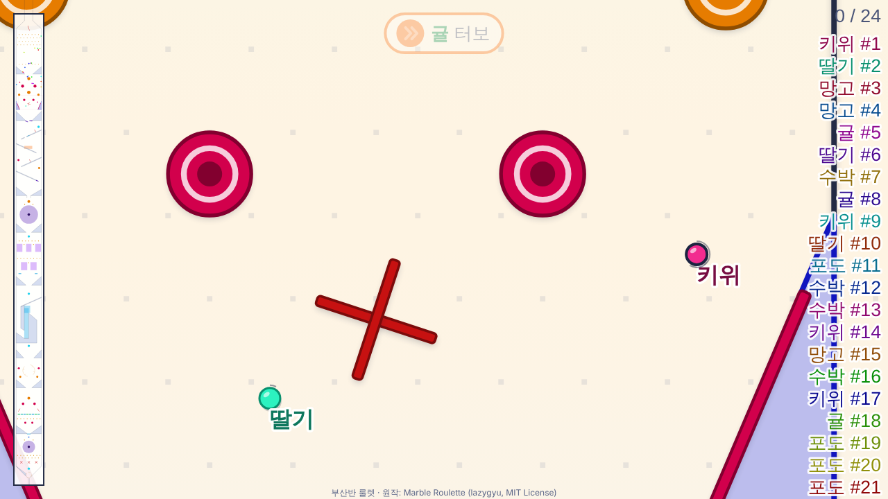
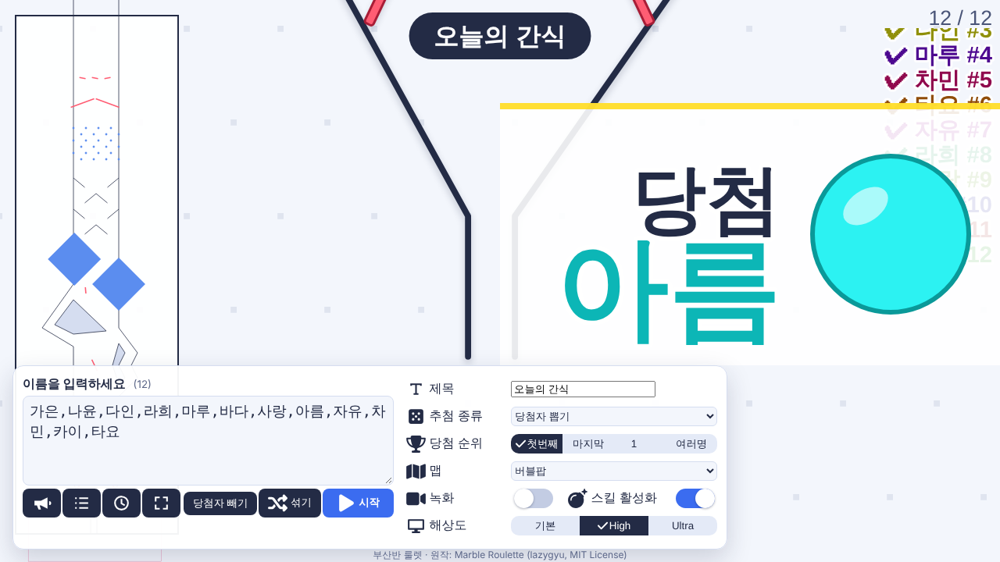
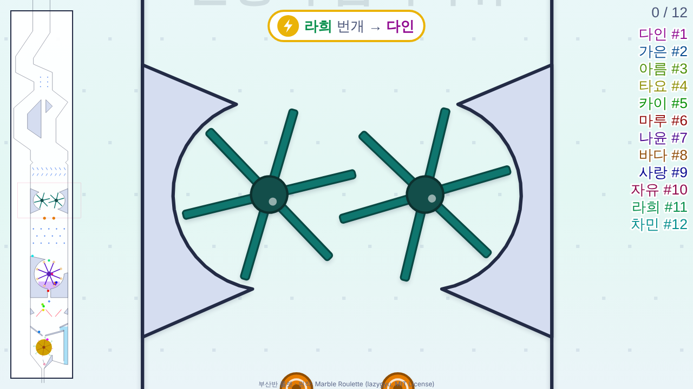
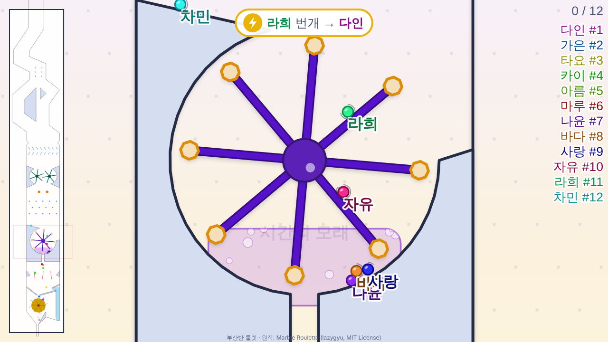
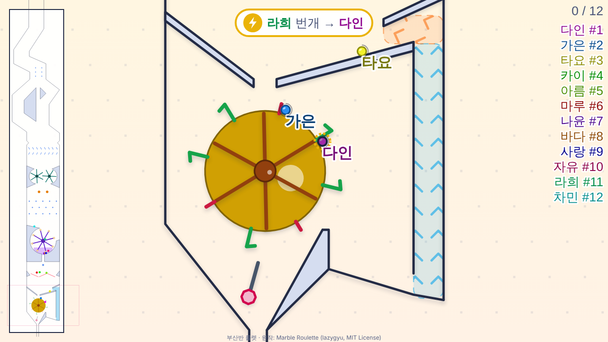
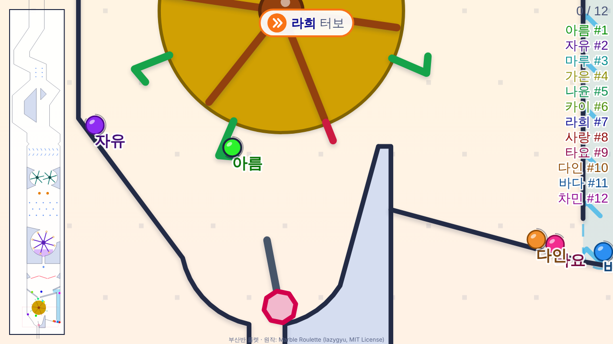

# 부산반 룰렛

구슬 경주로 간식, 자리, 모둠, 순서를 정하는 강의실용 추첨기입니다. 비영리 · 개인 용도로 만들었습니다.

> lazygyu 님의 [Marble Roulette](https://github.com/lazygyu/roulette) (MIT License) 을 바탕으로 만들었습니다.
> 원작과는 관계가 없는 별도 프로젝트이며, 원작의 이름과 로고는 쓰지 않습니다.

| 자리 배치 | 모둠 나누기 |
|---|---|
|  |  |

## 할 수 있는 것

설정의 **추첨 종류**에서 고릅니다. 이름을 넣고 시작을 누르면 구슬이 경주하고, 들어온 순서대로 결과를 정합니다.

| 추첨 종류 | 결과 | 예 |
|---|---|---|
| 당첨자 뽑기 | 첫번째, 마지막, n번째, 또는 여러 명 | 간식 당번, 발표자 |
| 순서 정하기 | 모두의 순서 | 발표 순서, 급식 순서 |
| 자리 배치 | 들어온 순서대로 앞줄 왼쪽부터 앉힌 자리표 (한 줄 자리 수를 정함) | 자리 바꾸기 |
| 모둠 나누기 | 들어온 순서대로 한 명씩 돌아가며 넣은 모둠 (모둠 크기 차이는 1명 이하) | 조 편성 |
| 간식 나누기 | 들어온 순서대로 목록의 간식을 하나씩 (`초코파이*3, 사탕*5`) | 간식, 상품 |

그 밖에:

- **추첨 제목**: 무엇을 뽑는 중인지 화면 위에 계속 보여 줍니다 (녹화에도 담깁니다).
- **명단**: 반 명단을 이름을 붙여 저장해 두고 불러옵니다 (최대 20개).
- **남은 경기 보기**: 당첨자가 정해진 뒤에도 남은 구슬의 경기를 끝까지 볼 수 있습니다. 당첨 표시는 4초 뒤 작게 줄고, 설정 창은 마지막 구슬이 들어온 뒤에 올라옵니다 (그 전에는 "설정 열기" 버튼). 스킬도 계속 터집니다.
- **당첨자 빼기**: 추첨이 끝나면 뽑힌 사람을 명단에서 빼고 바로 다시 돌릴 수 있습니다.
- **추첨 기록**: 최근 50건의 결과를 다시 보고 복사할 수 있습니다.
- **결과 복사**: 결과판의 내용을 글자로 복사합니다 (자리표는 표 프로그램에 붙여 넣을 수 있게 탭으로 구분).
- **전체 화면**, **녹화**(동영상 파일로 저장), 해상도 선택.
- **역전 스킬**: 뒤처진 구슬이 번개 · 터보 · 자리 바꾸기 · 중력장을 무작위로 써서 끝까지 순위가 뒤집힙니다.
- 맵 5개 (핀볼 오디세이, 운명의 수레바퀴, 버블팝, 항아리, 밤의 질주). 운명의 수레바퀴는 바퀴 보스 세 개를 지나는 코스로 새로 짰습니다.

이름 적는 법: 쉼표나 줄바꿈으로 구분합니다. `이름*3` 은 구슬 3개, `이름/2` 는 스킬을 더 자주 쓰는 구슬입니다.
주소 끝에 `#names=가,나,다` 를 붙여 열면 그 이름이 채워집니다.

## 정보 보호

- 페이지는 **다른 서버와 통신하지 않습니다.** 같은 주소의 자기 파일만 불러오고, 브라우저 보안 정책(CSP) 이 그것을 강제합니다.
- 입력한 이름, 명단, 기록은 **이 브라우저에만** 저장됩니다. 명단 창에서 저장을 끄거나 모두 지울 수 있습니다.
- 쿠키, 분석 도구, 광고, 글꼴 서버, 바깥으로 가는 링크가 없습니다.

들어 있는 외부 코드, 쓰는 브라우저 기능, 저장하는 항목, 이름이 밖으로 나갈 수 있는 경로, 확인하지 못한 것까지 **[PRIVACY.md](PRIVACY.md)** 에 모두 적었습니다.

브라우저는 2022년 이후 버전이 필요합니다 (Chrome · Edge 97, Firefox 102, Safari 16 이상).

## 원작 대비 달라진 점

| 항목 | 원작 | 부산반 룰렛 |
|---|---|---|
| 용도 | 당첨자 뽑기 | + **순서 정하기, 자리 배치, 모둠 나누기, 간식 나누기**, 명단 저장, 당첨자 빼기, 추첨 기록 |
| 광고 | 시작 전 프리롤(1.5초), 맵 안 광고판, 결과 화면 광고, 광고 서버 호출(1분마다) | **모두 제거** |
| 외부 전송 | 분석 서버로 시작 이벤트와 **입력한 이름**을 전송, 맵 공유마당 · 키워드 그림 서버 호출, 쇼핑몰 링크 | **없음.** 같은 주소의 파일만 불러오고 보안 정책(CSP) 으로 강제 |
| 제3자 그림 | 방송인 캐릭터 그림, 쇼핑몰 광고 이미지, 출처가 불분명한 아이콘 | 제거하거나 직접 그린 것으로 교체 |
| 화면 테마 | 검은 배경에 가는 네온 선 | **밝은 테마가 기본.** 채운 도형, 그림자, 광택 구슬, 역할별 색 |
| 기본 해상도 | 절반 해상도로 그려 확대 (흐릿함) | 화면 해상도 그대로 (High) |
| 기본 맵 | 4개 | **5개** (핀볼 오디세이 추가, 처음 열면 이 맵) |
| 가장 긴 맵 | 248 | **411** (핀볼 오디세이) |
| 첫 골인까지 (구슬 30개) | 5 ~ 23초 | 핀볼 오디세이 **약 64초** |
| 맵 요소 | 벽, 블록, 회전 막대, 범퍼, 부서지는 블록 | + **플리퍼, 왕복 발판·문, 부스터·바람, 젤리(슬로우), 블랙홀·화이트홀** |
| 스킬 | 주변 구슬을 밀어내는 충격파 1종 | + **역전 스킬 4종** (뒤처진 구슬에게만 무작위로) |

| 원작 | 부산반 룰렛 (같은 맵, 출발 4초 뒤) |
|---|---|
|  |  |

| 핀볼 오디세이: 범퍼 가든 | 핀볼 오디세이: 블랙홀 |
|---|---|
|  |  |

| 당첨자 뽑기 |
|---|
|  |

### 광고 제거

프리롤, 결승 지점 광고판, 결과 화면 광고와 광고 서버 호출(목록 받기, 노출 집계) 을 모두 뺐습니다.
시작 버튼을 누르면 바로 출발합니다.

### 밝은 테마 (빔 프로젝터용)

- 밝은 바탕에 짙은 테두리와 그림자. 벽은 굵게, 닫힌 도형은 속을 채워 그립니다.
- 역할마다 색이 다릅니다: 고정 블록(파랑), 움직이는 것(빨강), 범퍼(주황), 부서지는 블록(초록).
- 구슬에 테두리와 반사광을 넣었고, 이름은 흰 테두리를 둘러 어느 배경에서도 읽힙니다.
- 범퍼는 구슬이 닿으면 번쩍이고, 블록이 부서지면 조각이 튑니다.
- 어두운 배경용 색(파스텔, 흰색) 으로 만든 기존 맵은 색을 자동으로 어둡게 고쳐 보여 줍니다.
- 설정 창, 순위표, 미니맵, 당첨 표시도 같은 톤으로 맞췄습니다.
- 기본 해상도를 High 로 올려 큰 화면에서도 글자와 선이 또렷합니다.
- 어두운 테마는 코드에 남아 있습니다 (브라우저 콘솔에서 `roulette.setTheme('dark')`).

### 새 맵 요소

맵 데이터(`StageDef`) 에 아래 요소를 쓸 수 있습니다. 순위 계산(진행도 지도) 과 미니맵도 함께 지원합니다.

| 요소 | 맵 데이터 | 동작 |
|---|---|---|
| 플리퍼 | `motion.swing` + `wave: 'kick'` | 가만히 있다가 주기적으로 휘둘러 구슬을 쳐 냅니다 |
| 왕복 발판 · 여닫이 문 | `motion.slide` | 두 지점 사이를 오갑니다. 범퍼에 달면 움직이는 범퍼가 됩니다 |
| 부스터 · 바람 | `zones: { type: 'force' }` | 안에 든 구슬을 한 방향으로 밉니다. 위로 밀면 구슬이 떠오릅니다 |
| 젤리 (슬로우) | `zones: { type: 'slow' }` | 안에 든 구슬이 끈적하게 느려집니다 |
| 블랙홀 · 화이트홀 | `zones: { type: 'blackhole' }` | 끌어당겨 삼킨 뒤 화이트홀 중 한 곳으로 무작위로 내보냅니다 |
| 배경 · 구역 이름 | `background`, `labels` | 높이에 따라 바뀌는 배경색과 맵 위 글자 |

### 역전 스킬

"스킬 활성화" 를 켜 두면 3 ~ 5.5초마다 **하위 절반의 구슬 중 하나**가 (뒤에 있을수록 잘 뽑힙니다) 아래 스킬 중 하나를 씁니다.
구슬이 40개 늘 때마다 한 번에 스킬을 쓰는 구슬도 하나씩 늘어납니다 (최대 4).
누가 누구에게 무엇을 썼는지는 화면 위쪽에 표시됩니다.

| 스킬 | 종류 | 효과 |
|---|---|---|
| 터보 | 자기 버프 | 2.5초 동안 결승 방향으로 추진력을 받습니다 (경사로와 바람 리프트에서도 길을 따라갑니다) |
| 번개 | 선두 방해 | 선두(가끔 2 ~ 3등) 가 1.8초 동안 굼떠집니다 |
| 자리 바꾸기 | 방해 + 버프 | 0.7초 예고한 뒤 앞쪽 절반의 구슬 하나와 자리를 맞바꿉니다 |
| 중력장 | 선두 방해 | 선두가 있던 자리에 2.2초 동안 중력장이 생겨 주변 구슬을 붙잡습니다 (쓴 구슬은 영향 없음) |

### 새 맵: 핀볼 오디세이

핀볼 기계의 요소를 위에서 아래로 차례로 지나가는 맵입니다. 장애물 196개, 효과 구역 10개.

| 구역 | 내용 |
|---|---|
| 드롭 타깃 | 못 사이를 지나 부서지는 블록 두 줄을 뚫습니다. 앞선 구슬이 길을 터 주므로 뒤따르는 구슬이 따라붙습니다 |
| 범퍼 가든 | 범퍼, 슬링샷, 회전문에 튕기다가 플리퍼 사이로 빠집니다 |
| 지그재그 램프 | 경사로 네 개. 여닫이 다리(지름길), 부스터, 회전 막대, 끝의 플리퍼 |
| 블랙홀 | 삼켜지면 제자리 · 점프(젤리 늪 건너뛰기) · 되돌이(램프 다시 타기) 중 한 곳으로 나옵니다 |
| 젤리 늪 | 젤리에 빠지면 천천히 가라앉습니다. 젤리 사이가 빠른 길 |
| 바람 리프트 | 바람을 타고 굴뚝을 올라가 반대편으로 넘어갑니다 |
| 행운의 드럼 | 돌아가는 드럼 안에 갇히면 틈이 아래로 올 때까지 기다립니다 |
| 라스트 찬스 | 주기적으로 열리는 문에서 한데 모였다가 마지막 블랙홀을 지납니다 (결승 앞 또는 드럼 위로) |
| 결승 | 돌아가는 고리의 틈이 지나갈 때만 빠져나갑니다 |

### 운명의 수레바퀴 개편

원작의 지그재그 시작부는 그대로 두고, 그 아래를 바퀴 보스 세 개로 다시 짰습니다 (길이 111 → 155).

| 순서 | 보스 | 내용 |
|---|---|---|
| 초반 | 운명의 톱니바퀴 | 스포크 바퀴 두 개가 반대로 돌며 가운데서 살이 엇갈려 맞물립니다. 길은 두 바퀴 사이 "턱" 뿐이고, 살에 맞으면 튕겨 올라갑니다 |
| 중반 | 타로의 수레바퀴 + 시간의 모래 | 살 끝에 범퍼 손잡이가 달린 8살 바퀴가 모래(슬로우) 그릇을 쓸고 돕니다. 먼저 와도 모래에서 다 같이 모이고, 손잡이가 누구를 출구로 밀지 정합니다 |
| 마지막 | 운명의 관람차 + 진자 문지기 | 바퀴 테두리가 칸 8개로 나뉘어 있습니다. 깊은 칸(초록, 갈고리) 에 타면 결승으로, 얕은 칸(빨강) 에 타면 오른쪽 바람 리프트로 올라가 한 바퀴 더 탑니다. 결승 입구 위 그릇은 진자 문지기가 2.4초마다 휩쓸어, 그때 지나던 구슬을 관람차나 되돌이 칸으로 쳐냅니다 |

| 운명의 톱니바퀴 | 타로의 수레바퀴 | 운명의 관람차 |
|---|---|---|
|  |  |  |

끝부분에 먼저 도착한 구슬이 우승하는 비율 (시뮬레이션, 스킬 제외. 원작은 시드 8개, 개편 후는 시드 30개):

| 구슬 수 | 원작 (마지막 회전 막대 앞 1등) | 개편 후 (관람차 앞 1등) |
|---|---|---|
| 10개 | 75% | 30% |
| 30개 | 50% | 30% |

관람차에 한 번 탔을 때 결승 쪽으로 쏟아지는 확률은 구슬이 적으면 약 55~70%, 많으면 칸이 넘쳐 30~50% 입니다.
그렇게 결승 그릇까지 온 구슬 가운데 약 45% 는 진자 문지기에게 맞아 돌아갑니다 (혼자 온 구슬은 약 25%).

| 진자 문지기 |
|---|
|  |
시뮬레이션한 구슬 3 ~ 100개 모두 끼임 없이 완주했습니다.

### 수치로 본 비교

`yarn simulate bench 6,30,100` 결과입니다 (물리만 돌리는 시뮬레이션, 시드 고정, 스킬 제외).
새 맵은 구슬이 끼거나(shake) 완주하지 못한 경우가 없었습니다.

| 맵 | 길이 | 첫 골인 (구슬 6 / 30 / 100개) | 마지막 골인 (6 / 30 / 100개) |
|---|---:|---|---|
| **핀볼 오디세이** (신규) | 411 | 74.3초 / 63.5초 / 58.6초 | 117.7초 / 128.3초 / 177.7초 |
| **운명의 수레바퀴** (개편) | 155 | 30.8초 / 24.9초 / 24.9초 | 49.7초 / 78.9초 / 150.1초 |
| 버블팝 | 83 | 19.1초 / 15.9초 / 14.4초 | 22.4초 / 21.1초 / 47.3초 |
| 항아리 | 91 | 7.6초 / 4.8초 / 5.8초 | 57.5초 / 158.9초 / 126.7초 |
| 밤의 질주 | 248 | 37.0초 / 22.9초 / 19.2초 | 58.9초 / 61.3초 / 43.1초 |

버블팝 · 항아리 · 밤의 질주의 수치는 원작과 같습니다 (물리 동작을 바꾸지 않았습니다). 운명의 수레바퀴의 원작 수치는 첫 골인 12.6초 / 12.0초 / 10.0초, 마지막 골인 43.5초 / 46.2초 / 106.6초였습니다.
순서 정하기 · 자리 배치 · 모둠 나누기는 모두가 골인해야 끝나므로 "마지막 골인" 시간만큼 걸립니다. 빨리 끝내려면 버블팝이나 밤의 질주를 고르세요.

## 개발

필요한 것: Node.js, Yarn.

```shell
> yarn
> yarn dev
```

빌드 (결과는 `dist/`. `main` 에 올리면 GitHub Actions 가 빌드해서 GitHub Pages 로 배포합니다):

```shell
> yarn build
```

검사:

```shell
> yarn lint
> yarn simulate bench 6,30,100
```

## 라이선스

소스 코드는 [MIT License](./LICENSE) 입니다. 원작 Marble Roulette 의 저작권 표시(`Copyright (c) 2022 LazyGyu`) 를 그대로 둡니다.

### 함께 들어 있는 다른 사람의 저작물

| 대상 | 라이선스 | 쓰는 곳 |
|---|---|---|
| Marble Roulette (lazygyu) | MIT | 이 프로젝트의 바탕이 된 소스 |
| box2d-wasm 7.0.0 (Box2D, wasm-feature-detect 포함) | Zlib (MIT, Apache-2.0) | 물리 엔진 |
| tslib 2.8.1 | 0BSD | 번들에 들어가는 보조 함수 |
| Parcel runtime 2.16.4 | MIT | 번들에 들어가는 로더 |
| Font Awesome Free 아이콘 8개 | CC BY 4.0 | `assets/images/` 의 `bomb`, `check`, `ff`, `map`, `play`, `record`, `shuffle`, `trophy` (파일 안에 출처 표기) |

나머지 아이콘과 앱 아이콘은 이 프로젝트에서 직접 그렸습니다. "밤의 질주" 맵은 item4 님이 원작에 기여한 맵입니다.

### 이름

이 프로젝트의 이름은 **부산반 룰렛**입니다.
"Marble Roulette" 과 "마블 룰렛" 은 원작자 lazygyu 의 상표(대한민국 특허청 출원 중) 이고, MIT License 는 소스 코드에만 적용되며 그 이름을 쓸 권리는 포함하지 않습니다.
그래서 이 프로젝트는 다른 이름을 쓰고, 원작을 밝히는 용도로만 그 이름을 언급합니다.
