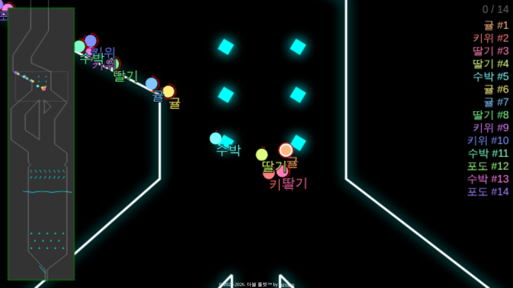
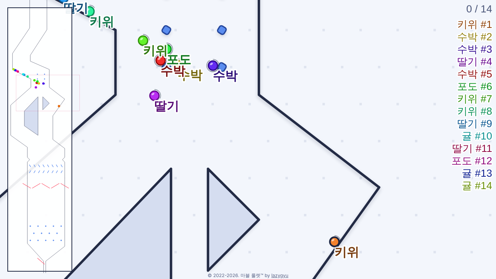
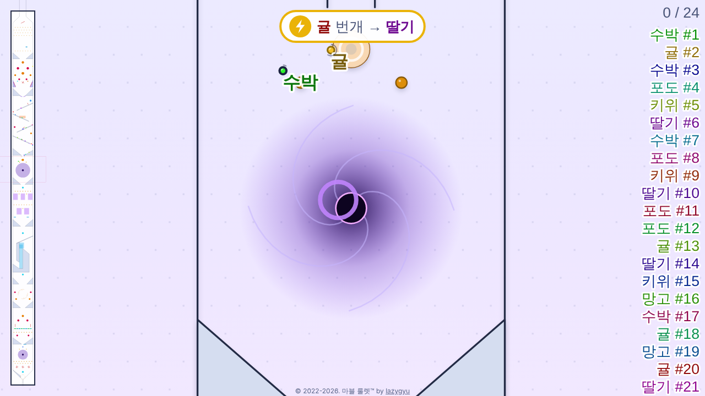

# Marble roulette

This is a lucky draw by dropping marbles.

> 이 저장소는 lazygyu 님의 [Marble Roulette](https://github.com/lazygyu/roulette) 를 바탕으로 한 포크입니다.
> 빔 프로젝터로 띄워 여럿이 함께 보는 추첨에 맞춰 고쳤습니다.

## 원본 Marble Roulette 대비 달라진 점

| 항목 | 원본 | 이 포크 |
|---|---|---|
| 광고 | 시작 전 프리롤(1.5초), 맵 안 광고판, 결과 화면 광고, 광고 서버 호출(1분마다) | **모두 제거** |
| 화면 테마 | 검은 배경에 가는 네온 선 | **밝은 테마가 기본.** 채운 도형, 그림자, 광택 구슬, 역할별 색 |
| 기본 해상도 | 절반 해상도로 그려 확대 (흐릿함) | 화면 해상도 그대로 (High) |
| 기본 맵 | 4개 | **5개** (핀볼 오디세이 추가, 처음 열면 이 맵) |
| 가장 긴 맵 | 248 (밤을 달리다) | **411** (핀볼 오디세이) |
| 첫 골인까지 (구슬 30개) | 5 ~ 23초 | 핀볼 오디세이 **약 64초** |
| 맵 요소 | 벽, 블록, 회전 막대, 범퍼, 부서지는 블록 | + **플리퍼, 왕복 발판·문, 부스터·바람, 젤리(슬로우), 블랙홀·화이트홀** |
| 스킬 | 주변 구슬을 밀어내는 충격파 1종 | + **역전 스킬 4종** (뒤처진 구슬에게만 무작위로) |

| 원본 | 이 포크 (같은 맵, 출발 4초 뒤) |
|---|---|
|  |  |

| 핀볼 오디세이: 범퍼 가든 | 핀볼 오디세이: 블랙홀 |
|---|---|
|  |  |

### 1. 광고 제거

프리롤, 결승 지점 광고판, 결과 화면 광고와 광고 서버 호출(목록 받기, 노출 집계) 을 모두 뺐습니다.
시작 버튼을 누르면 바로 출발합니다.

### 2. 밝은 테마 (빔 프로젝터용)

- 밝은 바탕에 짙은 테두리와 그림자. 벽은 굵게, 닫힌 도형은 속을 채워 그립니다.
- 역할마다 색이 다릅니다: 고정 블록(파랑), 움직이는 것(빨강), 범퍼(주황), 부서지는 블록(초록).
- 구슬에 테두리와 반사광을 넣었고, 이름은 흰 테두리를 둘러 어느 배경에서도 읽힙니다.
- 범퍼는 구슬이 닿으면 번쩍이고, 블록이 부서지면 조각이 튑니다.
- 어두운 배경용 색(파스텔, 흰색) 으로 만든 기존 맵과 받은 맵은 색을 자동으로 어둡게 고쳐 보여 줍니다.
- 설정 창, 맵 공유마당, 순위표, 미니맵, 당첨 표시도 같은 톤으로 맞췄습니다.
- 기본 해상도를 High 로 올려 큰 화면에서도 글자와 선이 또렷합니다.
- 어두운 테마는 코드에 남아 있습니다 (브라우저 콘솔에서 `roulette.setTheme('dark')`).

### 3. 새 맵 요소

맵 데이터(`StageDef`) 에 아래 요소를 쓸 수 있습니다. 순위 계산(진행도 지도) 과 미니맵도 함께 지원합니다.

| 요소 | 맵 데이터 | 동작 |
|---|---|---|
| 플리퍼 | `motion.swing` + `wave: 'kick'` | 가만히 있다가 주기적으로 휘둘러 구슬을 쳐 냅니다 |
| 왕복 발판 · 여닫이 문 | `motion.slide` | 두 지점 사이를 오갑니다. 범퍼에 달면 움직이는 범퍼가 됩니다 |
| 부스터 · 바람 | `zones: { type: 'force' }` | 안에 든 구슬을 한 방향으로 밉니다. 위로 밀면 구슬이 떠오릅니다 |
| 젤리 (슬로우) | `zones: { type: 'slow' }` | 안에 든 구슬이 끈적하게 느려집니다 |
| 블랙홀 · 화이트홀 | `zones: { type: 'blackhole' }` | 끌어당겨 삼킨 뒤 화이트홀 중 한 곳으로 무작위로 내보냅니다 |
| 배경 · 구역 이름 | `background`, `labels` | 높이에 따라 바뀌는 배경색과 맵 위 글자 |

### 4. 역전 스킬

"스킬 활성화" 를 켜 두면 3 ~ 5.5초마다 **하위 절반의 구슬 중 하나**가 (뒤에 있을수록 잘 뽑힙니다) 아래 스킬 중 하나를 씁니다.
구슬이 40개 늘 때마다 한 번에 스킬을 쓰는 구슬도 하나씩 늘어납니다 (최대 4).
누가 누구에게 무엇을 썼는지는 화면 위쪽에 표시됩니다.

| 스킬 | 종류 | 효과 |
|---|---|---|
| 터보 | 자기 버프 | 2.5초 동안 결승 방향으로 추진력을 받습니다 (경사로와 바람 리프트에서도 길을 따라갑니다) |
| 번개 | 선두 방해 | 선두(가끔 2 ~ 3등) 가 1.8초 동안 굼떠집니다 |
| 자리 바꾸기 | 방해 + 버프 | 0.7초 예고한 뒤 앞쪽 절반의 구슬 하나와 자리를 맞바꿉니다 |
| 중력장 | 선두 방해 | 선두가 있던 자리에 2.2초 동안 중력장이 생겨 주변 구슬을 붙잡습니다 (쓴 구슬은 영향 없음) |

### 5. 새 맵: 핀볼 오디세이

핀볼 기계의 요소를 위에서 아래로 차례로 지나가는 맵입니다. 장애물 196개, 효과 구역 10개.

| 구역 | 내용 |
|---|---|
| 드롭 타깃 | 못 사이를 지나 부서지는 블록 두 줄을 뚫습니다. 앞선 구슬이 길을 터 주므로 뒤따르는 구슬이 따라붙습니다 |
| 범퍼 가든 | 범퍼, 슬링샷, 회전문에 튕기다가 플리퍼 사이로 빠집니다 |
| 지그재그 램프 | 경사로 네 개. 여닫이 다리(지름길), 부스터, 회전 막대, 끝의 플리퍼 |
| 블랙홀 | 삼켜지면 제자리 · 점프(젤리 늪 건너뛰기) · 되돌이(램프 다시 타기) 중 한 곳으로 나옵니다 |
| 젤리 늪 | 젤리에 빠지면 천천히 가라앉습니다. 젤리 사이가 빠른 길 |
| 바람 리프트 | 바람을 타고 굴뚝을 올라가 반대편으로 넘어갑니다 |
| 행운의 드럼 | 돌아가는 드럼 안에 갇히면 틈이 아래로 올 때까지 기다립니다 |
| 라스트 찬스 | 주기적으로 열리는 문에서 한데 모였다가 마지막 블랙홀을 지납니다 (결승 앞 또는 드럼 위로) |
| 결승 | 돌아가는 고리의 틈이 지나갈 때만 빠져나갑니다 |

### 수치로 본 비교

`yarn simulate bench 6,30,100` 결과입니다 (물리만 돌리는 시뮬레이션, 시드 고정, 스킬 제외).
새 맵은 구슬이 끼거나(shake) 완주하지 못한 경우가 없었습니다.

| 맵 | 길이 | 첫 골인 (구슬 6 / 30 / 100개) | 마지막 골인 (6 / 30 / 100개) |
|---|---:|---|---|
| **핀볼 오디세이** (신규) | 411 | 74.3초 / 63.5초 / 58.6초 | 117.7초 / 128.3초 / 177.7초 |
| 운명의 수레바퀴 | 111 | 12.6초 / 12.0초 / 10.0초 | 43.5초 / 46.2초 / 106.6초 |
| 버블팝 | 83 | 19.1초 / 15.9초 / 14.4초 | 22.4초 / 21.1초 / 47.3초 |
| 욕망의 항아리 | 91 | 7.6초 / 4.8초 / 5.8초 | 57.5초 / 158.9초 / 126.7초 |
| 밤을 달리다 | 248 | 37.0초 / 22.9초 / 19.2초 | 58.9초 / 61.3초 / 43.1초 |

기존 맵 네 개의 수치는 원본과 같습니다 (기존 맵의 물리 동작은 그대로입니다).

---

[Demo (original)]( https://lazygyu.github.io/roulette )

# Requirements

- Typescript
- Parcel
- box2d-wasm

# Development

```shell
> yarn
> yarn dev
```

# Build

```shell
> yarn build
```

# License

The source code is licensed under the [MIT License](./LICENSE).

## Trademark

**"Marble Roulette"™** and **"마블 룰렛"™** are trademarks of lazygyu
(trademark applications pending in the Republic of Korea).

The MIT License applies to the **source code only**. It does **not** grant any
right to use these names, or any confusingly similar name, as the name or
branding of your own project, product, or service.

You may freely fork, modify, and redistribute this code, including for
commercial purposes, but please publish it under a different name. Nominative
use — factually referring to this project (e.g. "based on Marble Roulette by
lazygyu") — is fine.

**"마블 룰렛"™ / "Marble Roulette"™** 은 lazygyu의 상표이며 현재 대한민국
특허청에 상표 출원 중입니다. 소스 코드는 MIT 라이선스를 따르지만 위 명칭 및
이에 혼동을 줄 수 있는 유사 명칭은 라이선스 대상이 아닙니다. 포크·수정·재배포는
자유롭게 하시되 다른 이름을 사용해 주세요.
